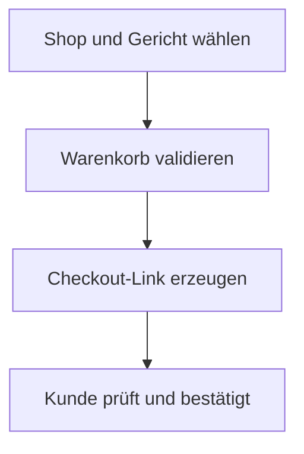

# Geführte Tour: Vom Schlüssel zum ersten Ergebnis

Diese Tour ist eine schriftliche Anleitung mit Beispielausgabe, keine Aufzeichnung eines Live-Aufrufs. Die öffentliche Freischaltung ist noch nicht bestätigt.

## 1 · Entwicklerzugang

Öffne nach Freischaltung [Foodzwerge Developers](https://foodzwerge.de/dev), registriere dich und bestätige deine E-Mail. Erstelle im Dashboard einen Schlüssel mit Leserechten. Kopiere ihn sofort: Er wird nur einmal vollständig angezeigt.

Du installierst ausschließlich dieses Kit. Die Bestellsoftware läuft bei Foodzwerge.

## 2 · Client verbinden

Führe die [Schnellstart-Befehle](../README.md#schnellstart) aus. Der Schlüssel wird verdeckt abgefragt.

```text
node examples/javascript/client.mjs --city Edemissen
```

## 3 · Ausgabe verstehen

Gekürztes, illustratives Beispiel – keine garantierten Live-Daten:

```json
{
  "server": {"name": "Foodzwerge", "version": "0.1.0"},
  "tools": {
    "tools": [
      {"name": "find_shops"},
      {"name": "shop_context"},
      {"name": "search_menu"}
    ]
  }
}
```

Danach folgt die Shopsuche mit `count` und `shops`. Jeder Treffer enthält einen `slug`. Verwende diesen für die nächsten Aufrufe. Auch eine leere Trefferliste kann eine erfolgreiche Antwort sein.

## 4 · Eigenen Assistenten anbinden

Mit dem JavaScript-Client in deiner eigenen Node-Anwendung:

```javascript
import { createClient } from './examples/javascript/client.mjs';

const client = createClient({
  url: process.env.FOODZWERGE_MCP_URL,
  token: process.env.FOODZWERGE_MCP_TOKEN,
});

await client.initialize();
const result = await client.callTool('find_shops', {
  city: 'Edemissen', order_type: 'pickup', limit: 5,
});
const data = result.data ?? result;
const shop = data.shops?.[0];

if (shop) {
  console.log(await client.callTool('shop_context', { shop_slug: shop.slug }));
  console.log(await client.callTool('search_menu', {
    shop_slug: shop.slug, query: 'Salami', limit: 5,
  }));
} else {
  console.log('Keine passenden Shops gefunden.');
}
```

Dieses Beispiel liest Daten und wählt zur Demonstration den ersten Treffer. Im echten Assistenten lässt du den Nutzer den passenden Shop und das Gericht wählen.

## 5 · Checkout freischalten

Projekt im Entwickler-Dashboard beschreiben und Freigabe anfragen. Nach Freigabe einen **neuen** Schlüssel mit Checkout-Rechten erstellen. Der alte Leseschlüssel behält seine bisherigen Rechte.

Danach stehen fünf Werkzeuge zur Verfügung. Der weitere [Bestellablauf](ordering-flow.md):



Aktuelle IDs und Preise immer aus den Antworten übernehmen. Ein Checkout-Link ist noch keine Bestellung.

## Noch kein Dienstzugang?

Starte `npm test` oder die Python-Tests aus dem README. Damit kannst du die Clients ohne Schlüssel gegen Mock-Antworten prüfen. Das ist keine öffentliche Demo-Bestellumgebung.
